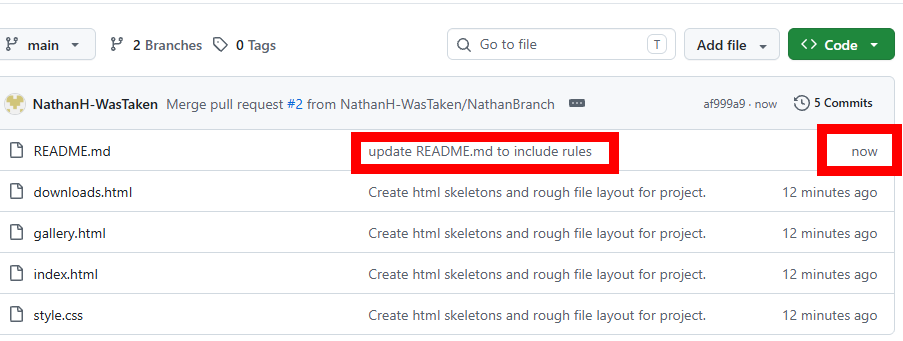

# cloud_comp-group7
Members: Nathan, Allen, David

# Rules
1. Always merge main into your branch before creating pull request with your changes (this helps avoid merge conflicts)
2. Merge main into your local branch if someone pushed their changes before starting your own changes (avoids conflicts)
3. Pull Request needs to be created to merge code to main (just as a reminder to notify people that you made changes, and helps have an update log of what changed)
4. Check that main did indeed receive your changes after merging pull request in (just a last check to ensure your changes were merged) 

## index.html
This is where the home page is.

## downloads.html
This is where the downloading page will be.

## gallery.html 
This is where the image gallery will be.

## style.css
This is where all styling will be.